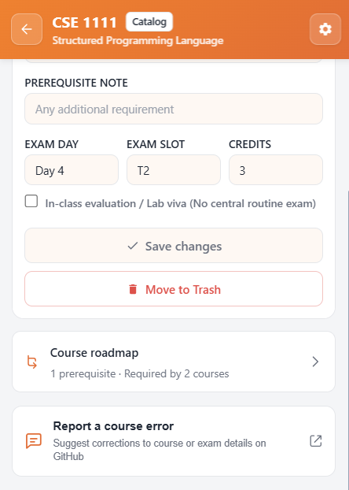
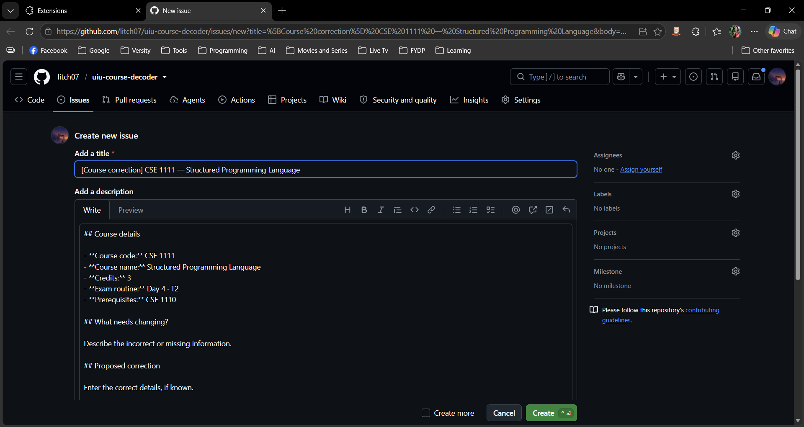
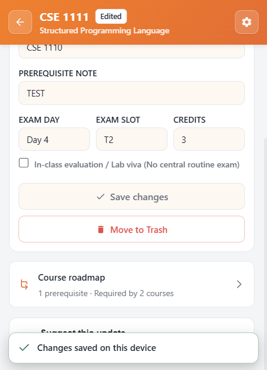
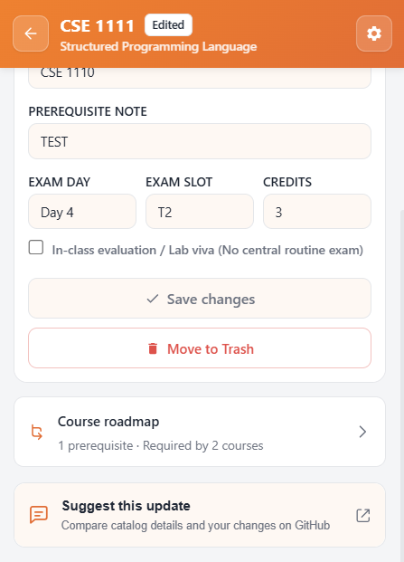
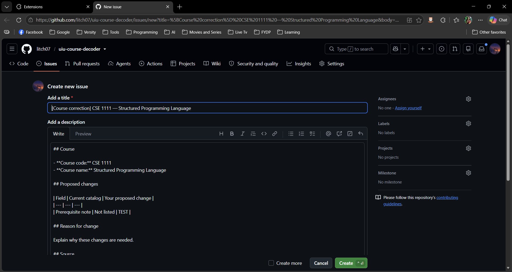
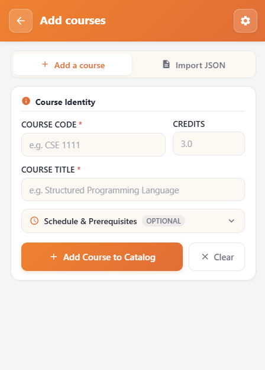
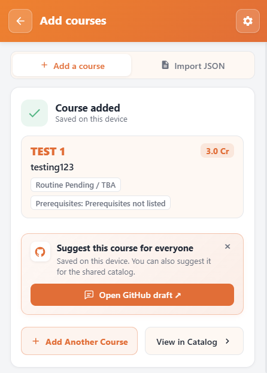
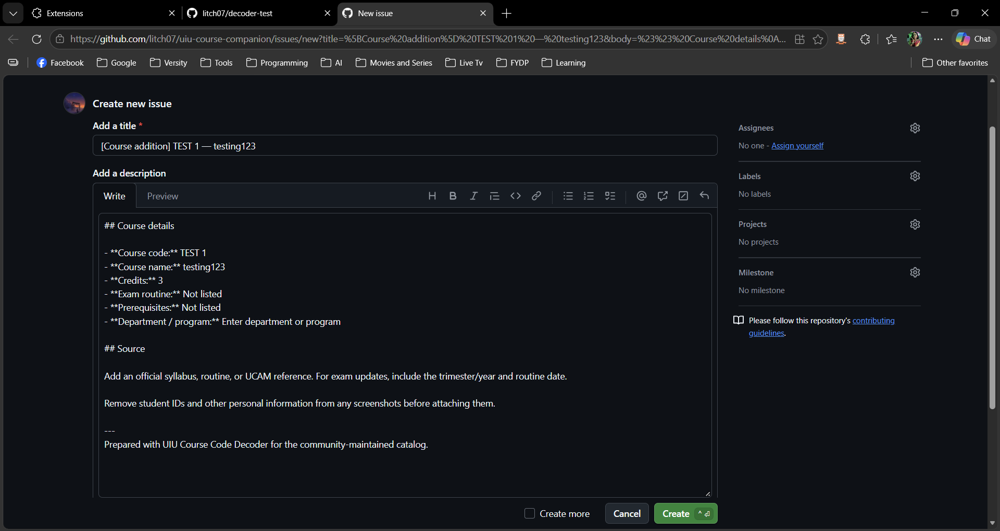

<p align="center">
  
</p>

<h1 align="center">Contributing to UIU Course Code Decoder</h1>

<p align="center">
  <strong>Help keep courses, prerequisites, and exam schedules accurate for all UIU students.</strong>
</p>

<p align="center">
  <a href="https://github.com/litch07/uiu-course-decoder/pulls"></a>
  
  
  
</p>

<p align="center">
  Thank you for helping keep the UIU course catalog accurate and up to date! This project is maintained by UIU students for students across all departments (<strong>BSCSE</strong>, <strong>BSDS</strong>, <strong>BSEEE</strong>, <strong>BBA</strong>, <strong>Pharmacy</strong>, <strong>Civil</strong>, and more).
</p>

---

## Two Ways to Contribute

| Method | Best For | Technical Skills Needed |
|:---|:---|:---:|
| **[1. One-Click In-App Suggestions](#1-suggest-changes-via-the-extension-no-coding-needed)** | Reporting wrong titles, missing courses, or prerequisite errors directly from the extension | **None** (Click & Submit) |
| **[2. Direct Pull Request (PR)](#2-contribute-via-pull-request-catalog-json)** | Adding large batches of departmental courses or editing `courses.json` directly | **Basic Git & JSON** |

---

## 1. Suggest Changes via the Extension (No Coding Needed)

You don't need to know Git, JSON, or JavaScript to help improve the catalog. The extension features built-in one-click tools that generate prefilled GitHub issues and PR drafts directly from your browser.

### A. Report an Error on an Existing Course
If a course title, credit count, or prerequisite listed in the catalog is incorrect:
1. Open the extension popup and go to **Course Catalog**.
2. Click the course to open its **Course Inspector**.
3. Scroll down and click **Report a course error**.
4. GitHub opens with the course details pre-filled. Describe what needs changing and submit!

| Extension Course Inspector | Prefilled Correction Issue Draft |
|:---:|:---:|
|  |  |

---

### B. Suggest an Update for an Edited Course
If you adjusted credits, prerequisites, or exam info directly on your device:
1. Edit any field in the **Course Inspector** and click **Save changes**. The course will be marked as `[Edited]`.
2. Scroll to the bottom and click **Suggest this update**.
3. GitHub opens with an automated Markdown comparison table showing your proposed changes side-by-side with current catalog values!

| 1. Saved Local Edits | 2. Suggest This Update | 3. Prefilled Comparison Diff Draft |
|:---:|:---:|:---:|
|  |  |  |

---

### C. Suggest a Brand-New Course
If your department has a new course or elective not yet in the shared catalog:
1. Open the popup and select **Course Catalog → Add courses → Add a course**.
2. Enter the Course Code (e.g. `CSE 1110`), Title (`Introduction to Computer Systems`), Credits (`1`), Exam Slot, and any known Prerequisites.
3. Click **Add course**.
4. On the success screen, click **Open GitHub draft ↗**.

| Add Course Form | Success & Draft Action | Prefilled GitHub Addition Draft |
|:---:|:---:|:---:|
|  |  |  |

> [!IMPORTANT]
> **Privacy & Verification Guidelines for Issues:**
> - **Cite Official Sources**: Mention where the course information comes from (e.g., official UIU course offering PDF, department curriculum handbook, or UCAM notice).
> - **Protect Personal Data**: When attaching screenshots of routines or grade sheets, **crop out or redact student IDs, names, and personal grades**.
> - **Cross-Department Prerequisites**: BSDS students routinely take CSE-coded courses, and CSE students take MATH/PHY courses. Cross-department prerequisites are completely normal and encouraged.

---

## 2. Contribute via Pull Request (Catalog JSON)

If you are comfortable with Git and JSON, you can add or update courses directly in root [`courses.json`](courses.json).

### Catalog JSON Schema
Each entry in `courses.json` uses the normalized uppercase course code as its key:

```json
{
  "CSE 1110": {
    "name": "Introduction to Computer Systems",
    "credits": 1,
    "examDay": "In-class",
    "examSlot": null,
    "prerequisites": [
      "None"
    ],
    "prerequisiteNote": null
  }
}
```

| Field | Type | Description & Accepted Values |
|:---|:---|:---|
| **Key** | `string` | Full normalized uppercase course code (e.g. `"CSE 1110"`, `"CSE 1111"`, `"CSI 217"`, `"CSE 4000A"`). |
| `name` | `string` | Required official full title of the course. |
| `credits` | `number \| null` | Finite positive number (e.g. `3`, `1.5`, `1`). Use `null` if officially unknown. |
| `examDay` | `string \| null` | E.g. `"Day 1"` through `"Day 7"`, `"In-class"` (for labs/thesis), or `null`. |
| `examSlot` | `string \| null` | E.g. `"T1"`, `"T2"`, `"T3"`, or `null`. Must be omitted/null if `examDay` is `"In-class"`. |
| `prerequisites` | `string[]` | Array of course codes. Use `["None"]` explicitly if there are no prerequisites. |
| `prerequisiteNote` | `string \| null` | Free-text notes for non-course conditions (e.g. `"Minimum 100 credits completed"`). |
| `prerequisiteVariants` | `object` *(optional)* | Map of curriculum IDs (e.g. `"BSDS-233"`) with `{ "prerequisites": [...], "source": "..." }`. |

---

### Prerequisite Guidelines & Graph Integrity
- **Exact Code Matching**: All prerequisite codes must exist in `courses.json` or be explicitly marked `["None"]`.
- **No Cycles or Self-Dependencies**: A course cannot depend on itself or create an infinite prerequisite loop (e.g., A → B → A).
- **Curriculum Variants**: Some courses have different prerequisites depending on program version (e.g., BSDS students taking `CSE 2215` have different prerequisites than BSCSE students). Use `prerequisiteVariants` to record source-backed differences without overwriting common defaults.
- **Credit Thresholds**: Put completed-credit milestones in `prerequisiteNote`, not inside the `prerequisites` code list.

---

## 3. Validating the Catalog Locally

No bundlers or package managers (`npm install`) are required! The repository includes a lightweight, zero-dependency validation script.

Before submitting a Pull Request, run the validator from the project root:

```sh
node scripts/validate_catalog.js
```

### Expected Output
```text
Catalog validated: 315 courses; no cycles or missing references.
REVIEW: DS 4229 requires CSE 3521: cross-program prerequisite; verify curriculum
...
```

The script verifies:
1. Valid JSON formatting and syntax.
2. Every prerequisite code exists in the catalog.
3. Prerequisite graphs are strictly acyclic (no circular chains).
4. Credit counts and exam slot conventions are valid.

---

## 4. Pull Request Checklist

Before opening your Pull Request:
- [ ] Added or modified course records in [`courses.json`](courses.json).
- [ ] Course codes follow standard uppercase spacing (e.g., `CSE 1110`, not `cse1110` or `CSE1110`).
- [ ] Ran `node scripts/validate_catalog.js` and confirmed it passes with 0 errors.
- [ ] Provided an official source reference (link or document name) in the PR description.
- [ ] Pull Request title follows conventional naming (e.g., `feat(catalog): update CSE 1110 metadata`).

Every Pull Request automatically triggers GitHub Actions (`.github/workflows/validate-catalog.yml`) to verify schema and graph integrity before merging.

---

## 5. Sample Pull Request Demo

Here is a real-world example of what an approved course addition or update Pull Request looks like on GitHub:

### Example PR Title:
```text
feat(catalog): update CSE 1110 exam schedule and prerequisite metadata
```

### Example PR Description:
````markdown
### Summary of Changes
- Updated `CSE 1110` (Introduction to Computer Systems, 1.0 Credit)
- Marked exam routine as `In-class` / lab viva (no central routine slot)
- Explicitly set prerequisites to `["None"]` as it is a foundation course

### Changes to `courses.json`:
```json
"CSE 1110": {
  "name": "Introduction to Computer Systems",
  "credits": 1,
  "examDay": "In-class",
  "examSlot": null,
  "prerequisites": [
    "None"
  ],
  "prerequisiteNote": null
}
```

### Official UIU Curriculum Reference
- Source: UIU Department of CSE Undergraduate Curriculum Handbook (Page 14)
- URL: https://cse.uiu.ac.bd/undergraduate/curriculum/

### Local Validation Run
```sh
$ node scripts/validate_catalog.js
Catalog validated: 315 courses; no cycles or missing references.
```
````

> [!TIP]
> You don't need to write long essays—just clearly state what changed, cite the official UIU document or URL, and confirm that `node scripts/validate_catalog.js` passes!

---

<p align="center">
  <strong>UIU Course Code Decoder</strong> · Distributed under the <a href="LICENSE">MIT License</a>.
</p>
