

  

<h1 align="center">UIU Course Code Decoder — User Manual</h1>

  <strong>The complete visual reference handbook for United International University students.</strong>

  
  
  
  

  This manual provides an in-depth walkthrough of every feature, display mode, and workflow in the <strong>UIU Course Code Decoder</strong> extension. Whether you are navigating course registration, reading advising routines on UCAM, tracing prerequisite chains, or planning clash-free exams, this guide has you covered.

---

## Chapter 1: Getting Started

### 1.1 Pinning to Your Toolbar
After installing the extension, click your browser's puzzle icon (Extensions) and pin **UIU Course Code Decoder** to your toolbar for immediate one-click access.

### 1.2 First-Run Welcome Card
On your first launch, the extension presents a streamlined onboarding card. Click **Get started** to initialize the default university course catalog. No registration, login, or personal details are required.

### 1.3 Home Dashboard Overview
Clicking the toolbar icon opens the compact popup dashboard:

| First-Run Onboarding | Home Dashboard |
|:---:|:---:|
|  |  |

From the Home tab, you can:
- **Toggle In-Page Decoding**: Enable or disable automatic decoding for the active website with a single master switch.
- **Select Display Mode**: Switch between **Highlight**, **Tooltip**, and **Inline** modes instantly.
- **Metadata Switches**: Choose whether hover cards display official exam schedules and prerequisite links.

---

## Chapter 2: In-Page Schedule Decoding

When browsing university portals (**UCAM** and **eLMS**), the extension automatically identifies UIU course codes (such as `CSE 1111`, `CSI 217`, `BMT 1103`, `DS 1501`) and enriches them in real time.

### 2.1 The Three Display Modes

Choose the display treatment that best fits your workflow:

| Mode | Appearance | Best Used For |
|:---|:---|:---|
| **Highlight** | Soft tinted background badge. Hovering or focusing opens an adaptive details card. | Dense schedule tables where column widths must stay intact. |
| **Tooltip** | Subtle dotted underline beneath code text. Hovering opens course details. | Clean, minimal reading without altering page styling. |
| **Inline** | Expands and inserts the full official course title directly next to the code. | Quick scanning of routines without needing to move the mouse. |

#### Visual Comparison on UCAM Class Routine Tables:

| Highlight Mode (Hover Card) | Tooltip Mode (Subtle Dotted Underline) | Inline Mode (In-Place Full Titles) |
|:---:|:---:|:---:|
| 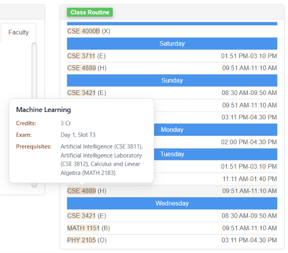 | 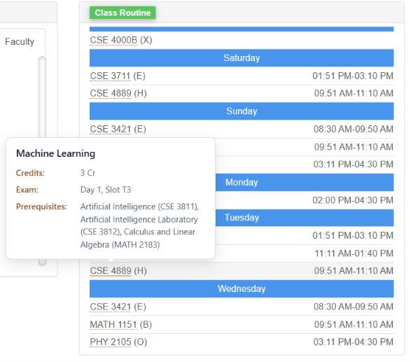 | 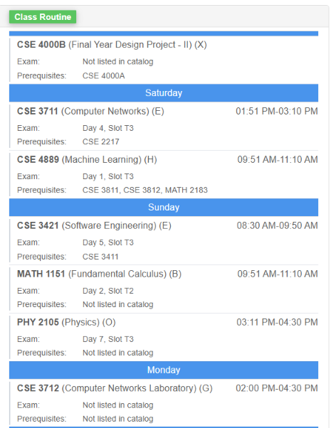 |
| *Hovering `CSE 4889` displays title, credits, exam slot, and prerequisite dependencies.* | *Underlined `CSE 4889` reveals Machine Learning credits, exam schedule, and prerequisites.* | *Titles are appended directly inside table cells without breaking routine row heights.* |

> [!TIP]
> **Boundary-Aware Tooltips**: Hover cards automatically detect screen edges. If a course code appears near the bottom of your browser window, the card flips smoothly upward so it never clips off-screen.

---

### 2.2 UCAM Attendance Graph Integration

On UCAM's student attendance dashboard, the extension integrates directly into Highcharts attendance visualizations:

  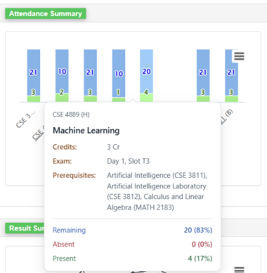

- **Hover to Inspect**: Hover over any course bar to see your **Present**, **Absent**, and **Remaining** classes alongside course credits and prerequisite rules.
- **Click to Pin**: Click any attendance bar to pin the card in place, allowing you to review details without holding the mouse steady. Press `Esc` or click outside to dismiss.

---

## Chapter 3: Course Catalog & Prerequisite Roadmap

The extension includes a 100% offline, searchable database of over 300 UIU undergraduate courses across engineering, data science, business, and basic sciences.

### 3.1 Searching the Catalog
Open **Course Catalog** from the bottom navigation bar. Type any course code (e.g. `CSE 111`) or title keyword to instantly filter courses with live match counters, credit badges, and prerequisite tags:

  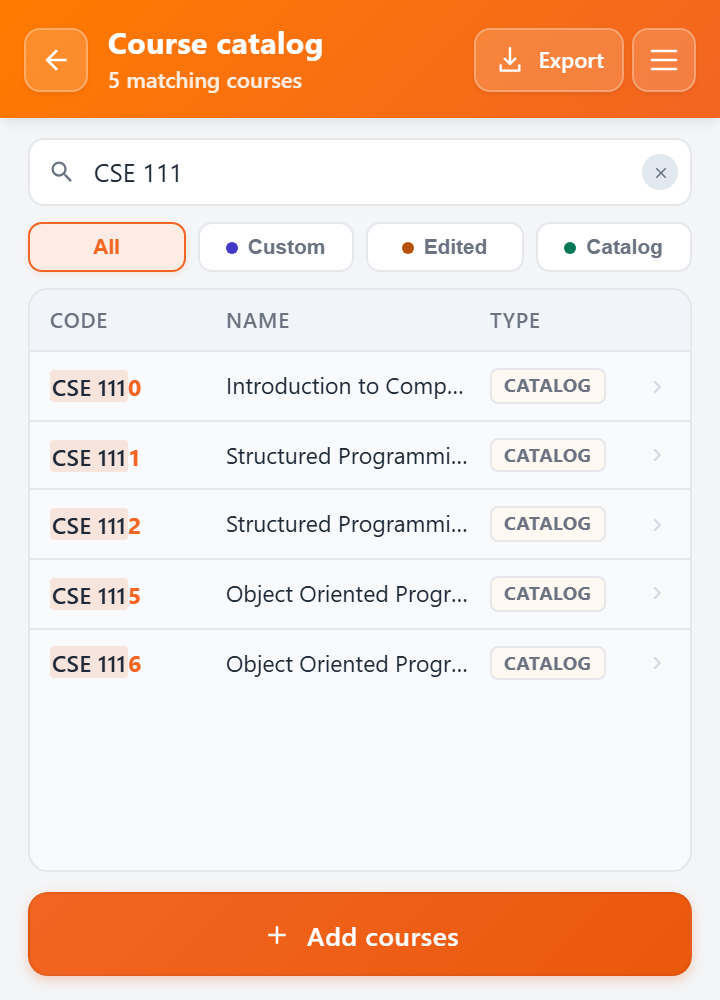

---

### 3.2 The Course Inspector
Clicking any course opens its comprehensive **Course Inspector**:

| Course Information & Schedule | Prerequisites & Actions |
|:---:|:---:|
| 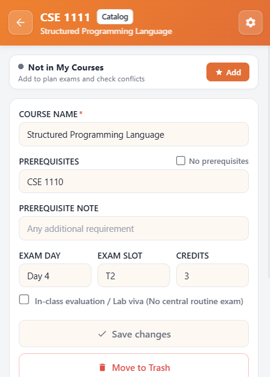 | 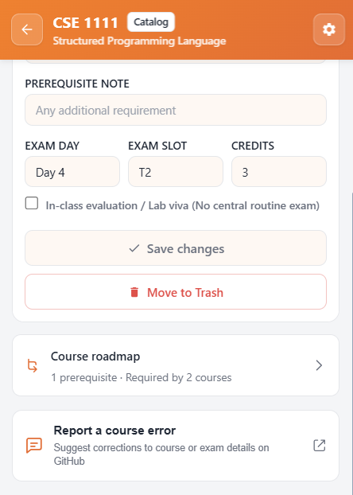 |

- **Official Metadata**: View credit weight, central exam day, and exam time slot.
- **In-Class vs Routine Exams**: Toggle courses evaluated in-class (e.g., labs, project vivas, thesis) vs those following the university's central exam routine.
- **My Courses Toggle**: Mark a course as enrolled to add it to your personal exam clash planner.
- **Custom Notes**: Review special requirements (such as minimum completed credits).

---

### 3.3 Visual Prerequisite Roadmap
From the Course Inspector, tap **Course roadmap** to explore the complete dependency tree for that subject:

  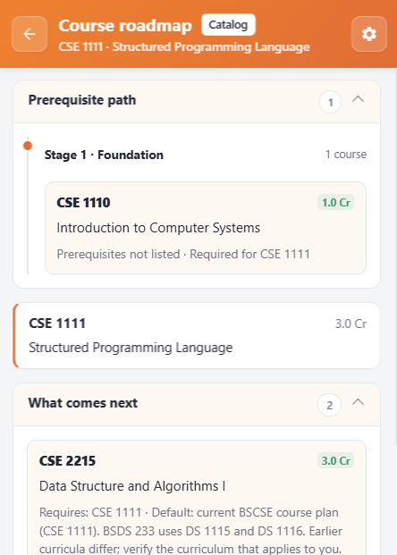

1. **Prerequisite Path (*What you need first*)**:
   - Traces the exact foundation courses you must pass before enrolling.
   - Organized into logical, bottom-up stages (e.g., `Stage 1: Foundation`).
2. **What Comes Next (*Future unlocks*)**:
   - Lists advanced departmental courses that require this subject.
   - Shows program-specific curriculum variants (e.g. `BSDS-233` requirements).
3. **Interactive Navigation**:
   - Click any prerequisite chip to jump straight to that course's roadmap.

---

## Chapter 4: Automated Exam Clash Planner

During course registration and advising, scheduling exams without conflicts is crucial. The **My courses & exams** planner automates this process:

| Initial Setup (Empty State) | Active Schedule (Clash Warnings & Conflicts) |
|:---:|:---:|
|  | 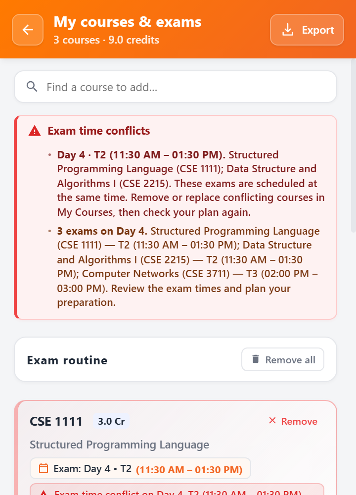 |
| *Start by adding courses from the search bar or directly from the catalog.* | *Instant visual alerts for same-slot conflicts, same-day exams, and total tuition credits.* |

### Key Capabilities:
- **Same-Slot Conflict Detection**: If two selected courses share the exact same exam time (e.g., **Day 4, Slot T2** conflict between `CSE 1111` and `CSE 1112`), the planner immediately highlights them with high-visibility warning banners.
- **Daily Exam Load Monitoring**: Alerts you when multiple exams fall on the same day (e.g., *"3 exams scheduled on Day 4"*), helping you avoid overloaded study days.
- **Tuition Credit Calculator**: Automatically tallies completed and active course credits in real time.
- **Markdown Schedule Export**: Click **Export Markdown** to download a formatted, readable routine for printing or sharing with advisors.

---

## Chapter 5: Course & Catalog Management

Need to add new electives, adjust schedule information, or update departmental offerings? The extension provides full catalog customization.

### 5.1 Adding an Individual Course
Navigate to **Course Catalog → Add courses → Add a course**:

| Basic Details | Schedule & Prerequisites Accordion |
|:---:|:---:|
| 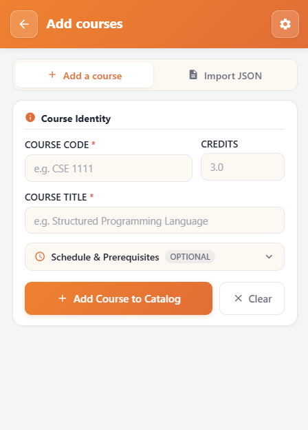 | 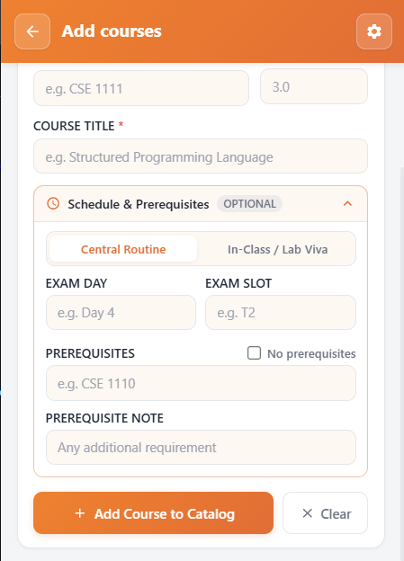 |

1. Enter the normalized **Course Code** (e.g., `CSE 1110`), **Course Title**, and **Credits**.
2. Expand the **Schedule & Prerequisites** accordion to specify Exam Day, Slot (`T1`, `T2`, `T3`), and prerequisite codes.
3. Tap **Add course** to save it locally.

---

### 5.2 Batch Catalog Import (JSON)
For batch updates across entire departments, use the **Import JSON** tool:

| 1. Upload or Paste Schema | 2. Detection & Ready State | 3. Diff Review & Validation |
|:---:|:---:|:---:|
| 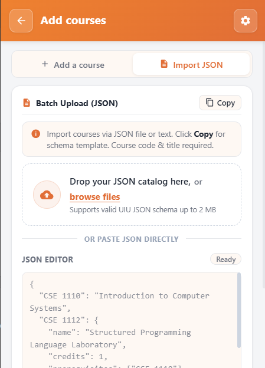 | 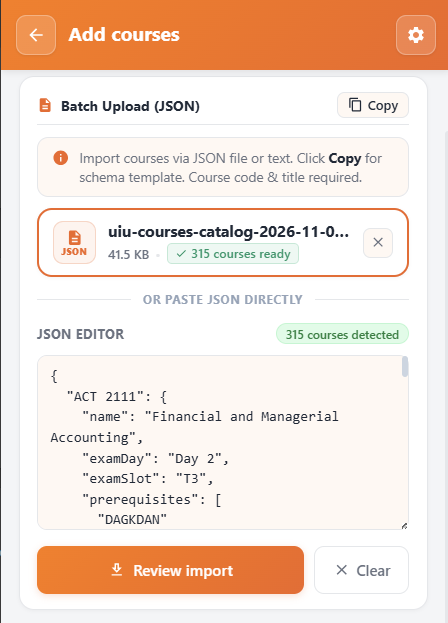 | 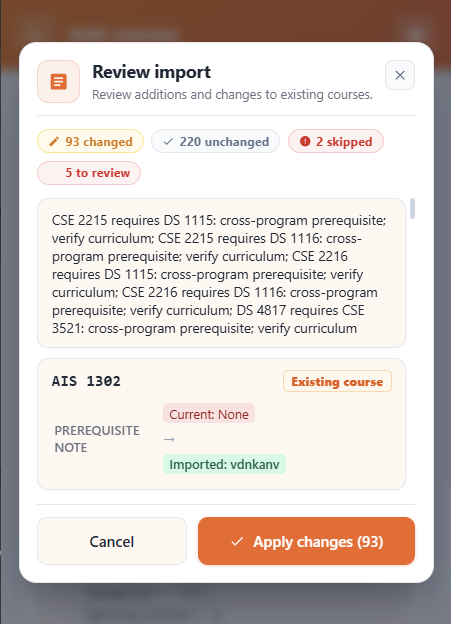 |

- **Drag-and-Drop File Upload**: Drop any valid `.json` catalog file (up to 2 MiB) directly onto the upload zone.
- **Built-In JSON Editor**: Paste or edit catalog JSON directly with syntax checking and live course counts.
- **Safe Diff Review Modal**: Before applying changes, a review dialog breaks down exact changes (`Changed`, `Unchanged`, `Skipped`, `To review`) and displays side-by-side field diffs.

---

## Chapter 6: Trash, Maintenance & Settings

### 6.1 Safe Deletion & Trash Recovery
Accidentally deleted a course? The extension features safe soft-deletion and trash recovery:

| 1. Select "Move to Trash" | 2. Deletion Toast & Menu Badge | 3. Dedicated Trash & Recovery |
|:---:|:---:|:---:|
|  | 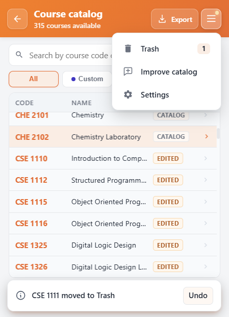 | 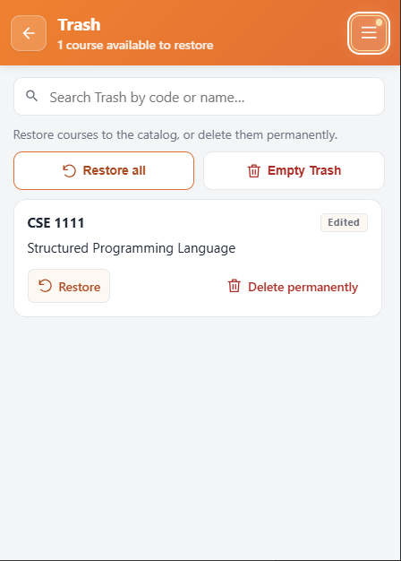 |
| *Click the red Move to Trash button inside any Course Inspector.* | *Instant Undo toast appears, and the hamburger menu highlights the Trash count badge.* | *Restore individual courses, empty the trash, or permanently exclude courses.* |

- **Instant Undo**: A snackbar toast provides an **Undo** action immediately after deletion.
- **Trash Drawer**: Deleted courses are safely isolated in the **Trash** drawer with live item counters.
- **Restoration**: Restore individual courses or choose **Restore all** at any time.

---

### 6.2 Contextual Catalog Export
Export your course records for backups, semester sharing, or curriculum development:

| Full Catalog Export Dialog | Contextual Filtered Export |
|:---:|:---:|
| 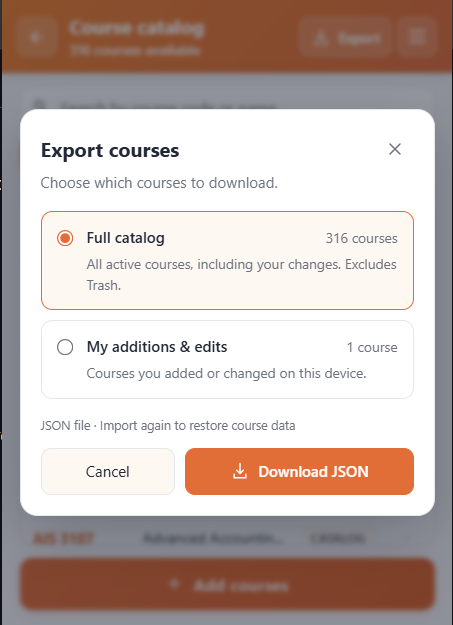 | 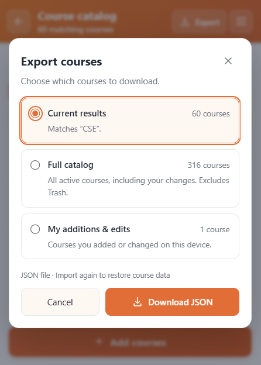 |

- **Full Catalog**: Export all departmental courses into a standard UIU JSON catalog.
- **Filtered Export**: When searching or filtering, export only the matching subset of courses.

---

### 6.3 Settings, Permissions & Remote Sync

Access extension settings via the top-right gear icon:

| Allowed Domains & Theme | Remote Curriculum Sync |
|:---:|:---:|
| 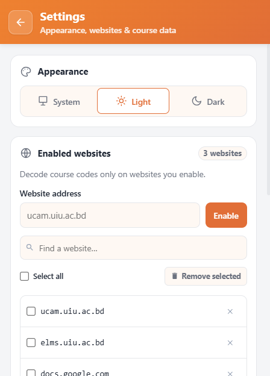 | 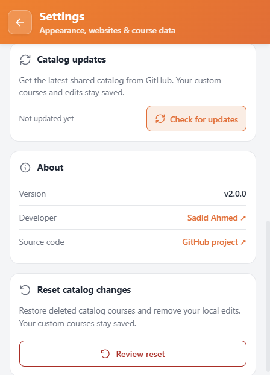 |

- **Enabled Websites**: Toggle permissions for university domains (`ucam.uiu.ac.bd`, `elms.uiu.ac.bd`) or add custom domains.
- **Appearance**: Select **System**, **Light**, or **Dark** themes.
- **Check for Updates**: Fetch official community catalog updates directly from the shared GitHub repository without reinstalling the extension.
- **Reset Catalog Changes**: Restore all original bundled course records while preserving your custom electives.

---

## Appendix: Keyboard Shortcuts & Accessibility

| Key / Action | Function |
|:---|:---|
| `Esc` | Closes any open tooltip hover card, export dialog, or review modal. |
| `Tab` / `Shift + Tab` | Accessible keyboard focus across routine table links, cards, and popup buttons. |
| `Enter` / `Space` | Activates focused course chips, opens roadmaps, or pins attendance graph cards. |
| `Ctrl + F` / `/` | Focuses the search input in the Course Catalog. |

---

  <strong>UIU Course Code Decoder</strong> · An open-source utility for United International University. 
  Found an error or missing course? <a href="CONTRIBUTING.md">Submit an update</a> via GitHub.

