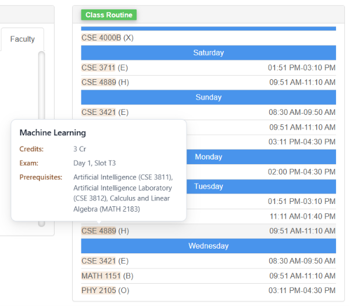
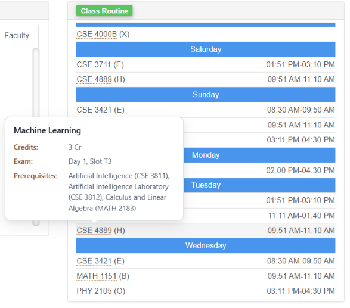
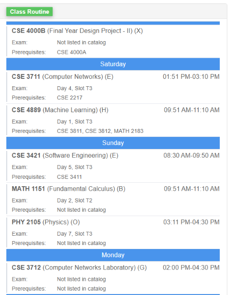
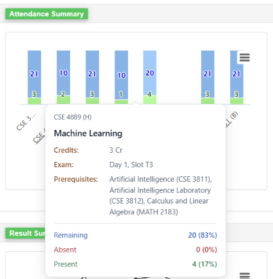
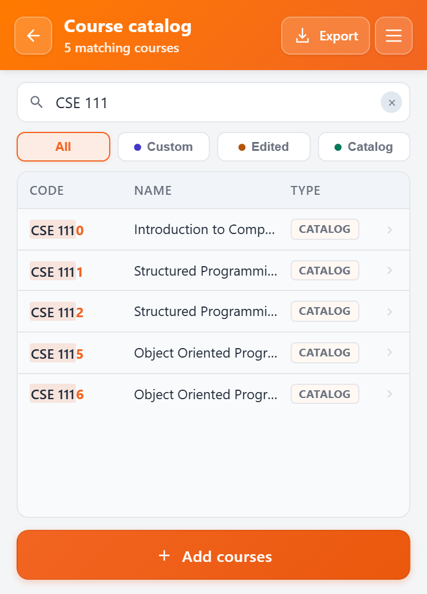
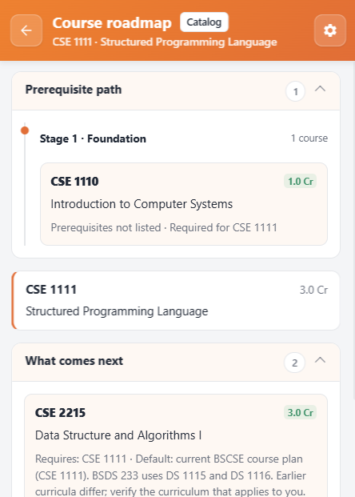
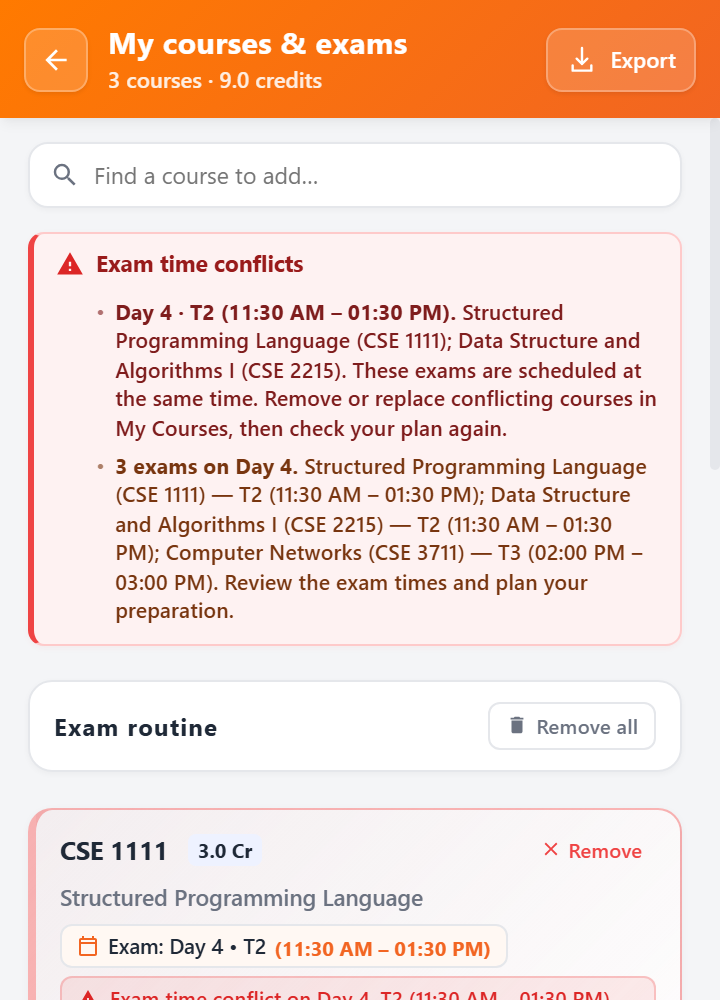
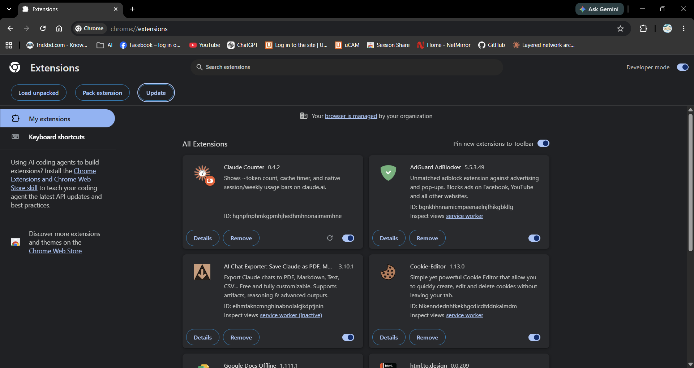
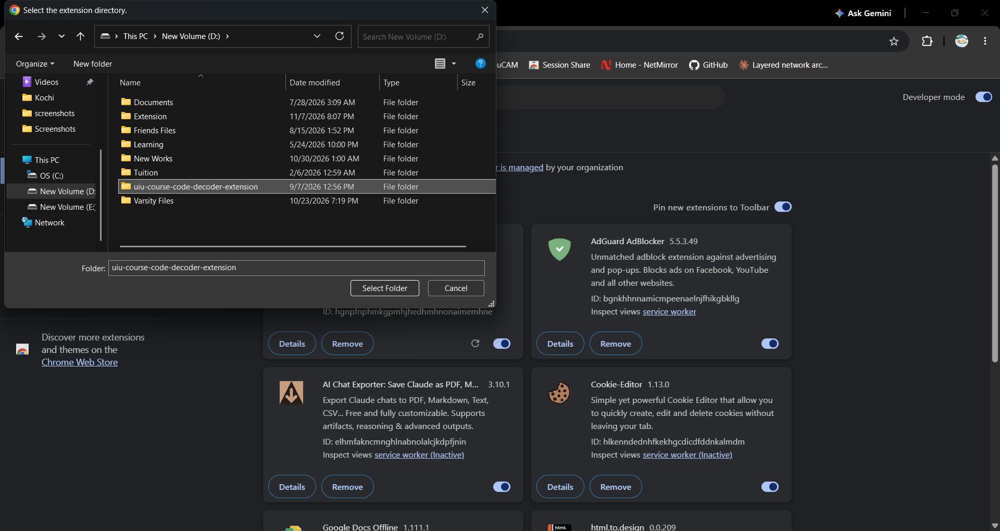

  

<h1 align="center">UIU Course Code Decoder</h1>

  <strong>Decode courses. Map prerequisites. Avoid exam clashes.</strong>

  
  
  
  
  

  A lightweight, privacy-first browser extension for <strong>United International University (UIU)</strong> students across all academic programs. Automatically translates course codes across university portals into full course titles, visualizes prerequisite dependency trees, and detects schedule conflicts with an automated exam clash planner.

---

## Features

### 1. In-Page Schedule Decoding (UCAM & eLMS)

Translates course codes (`CSE 1111`, `CSI 217`, `BMT 1103`, `DS 1501`, etc.) directly inside active class routines, advising schedules, and grade sheets with three selectable display treatments:

| Highlight Mode | Tooltip Mode | Inline Mode |
|:---:|:---:|:---:|
|  |  |  |
| *Hovering `CSE 4889` opens an adaptive card with title, credits, exam slot, and prerequisites.* | *Hovering dotted code `CSE 4889` reveals Machine Learning details in a lightweight popup.* | *Full course titles are inserted directly into routine tables without breaking column widths.* |

- **Highlight Mode**: Subtle colored background; hover or focus opens an adaptive details card.
- **Tooltip Mode**: Minimalist dotted underline beneath codes with lightweight hover cards.
- **Inline Mode**: Appends course titles directly next to codes for quick routine scanning.
- **Boundary-Aware Viewport**: Tooltip cards dynamically adjust orientation so they never clip off the screen edge.

---

### 2. UCAM Attendance Graph Integration

Hover over any course bar in UCAM's Highcharts attendance analytics to inspect attendance counts alongside course information. Click any bar to pin the card in place.

  

---

### 3. Extension Popup Dashboard

Click the toolbar icon to access the compact dashboard:

| Home Dashboard | Course Catalog | Prerequisite Roadmap | Exam Clash Planner |
|:---:|:---:|:---:|:---:|
|  |  |  |  |

- **Home Dashboard**: Master on/off toggle, mode selector (Highlight / Tooltip / Inline), and metadata switches.
- **Course Catalog**: Instant offline search across 300+ UIU courses by code or title with credit tags, exam slots, and prerequisite chips.
- **Prerequisite Roadmap**: Visual sequence tracking foundation courses required first (*Prerequisite path*) and advanced courses unlocked downstream (*What comes next*).
- **Exam Clash Planner**: Real-time conflict detection highlighting same-slot exam clashes (e.g., **Day 4 T2** conflict), daily exam counts, total tuition credit calculation, and Markdown schedule export.

---

## Documentation

Comprehensive guides are available in the repository:

- **[User Manual (MANUAL.md)](MANUAL.md)**: Complete step-by-step handbook covering all 26 views, batch JSON catalog importing, and trash recovery workflows.
- **[Contributing Guide (CONTRIBUTING.md)](CONTRIBUTING.md)**: Instructions for reporting course data errors, suggesting electives via the extension, or submitting catalog Pull Requests.
- **[Privacy Policy (PRIVACY.md)](PRIVACY.md)**: Detailed breakdown of permissions and local-only client storage.
- **[Security Architecture (SECURITY.md)](SECURITY.md)**: Zero-innerHTML DOM policy, graph integrity checks, and validation architecture.

---

## Installation

### Official Browser Stores

- **Microsoft Edge**: [Install from Edge Add-ons](https://microsoftedge.microsoft.com/addons/detail/uiu-course-code-decoder/dnahpleadipkgknggmeeljcnmhcodpgk?hl=en-US)
- **Mozilla Firefox**: [Install from Firefox Add-ons](https://addons.mozilla.org/en-US/firefox/addon/uiu-course-code-decoder/)

### Direct Installation (Google Chrome, Brave, Opera)

For browsers without a direct web store listing, load the extension in under 30 seconds via **Developer Mode**:

1. **Download the source**: Download this repository as a [ZIP archive](https://github.com/litch07/uiu-course-decoder/archive/refs/heads/main.zip) (or run `git clone`) and extract it.
2. **Open Extensions Manager**:
   - **Google Chrome**: `chrome://extensions/`
   - **Brave**: `brave://extensions/`
   - **Opera**: `opera://extensions/`
3. **Enable Developer Mode**: Turn ON the **Developer mode** toggle in the top-right corner.
4. **Load the Extension**: Click **Load unpacked** in the top-left toolbar and select the extracted project folder containing `manifest.json`.

  
<strong>View Step-by-Step Developer Mode Screenshots</strong>

   

  

    <strong>Step 1: Turn on Developer Mode</strong> 
    <em>Enable the Developer mode toggle in the top-right corner of your browser's extensions manager.</em>  
    
  

   

  

    <strong>Step 2: Click "Load unpacked" and Select Extracted Folder</strong> 
    <em>Click Load unpacked and select the directory containing manifest.json.</em>  
    
  

---

## Privacy & Security

- **100% Client-Side**: All decoding, catalog modifications, and exam routines remain strictly local in your browser (`chrome.storage.local`).
- **Zero Telemetry**: No analytics, no tracking, no remote database, and no external tracking scripts.
- **Zero-innerHTML DOM Architecture**: All in-page rendering uses programmatic DOM node construction (`document.createElement`, `textContent`) to prevent HTML injection vulnerabilities.

---

## License & Credits

Developed and maintained by **[Sadid Ahmed](https://github.com/litch07)**.  
Distributed under the [MIT License](LICENSE).
